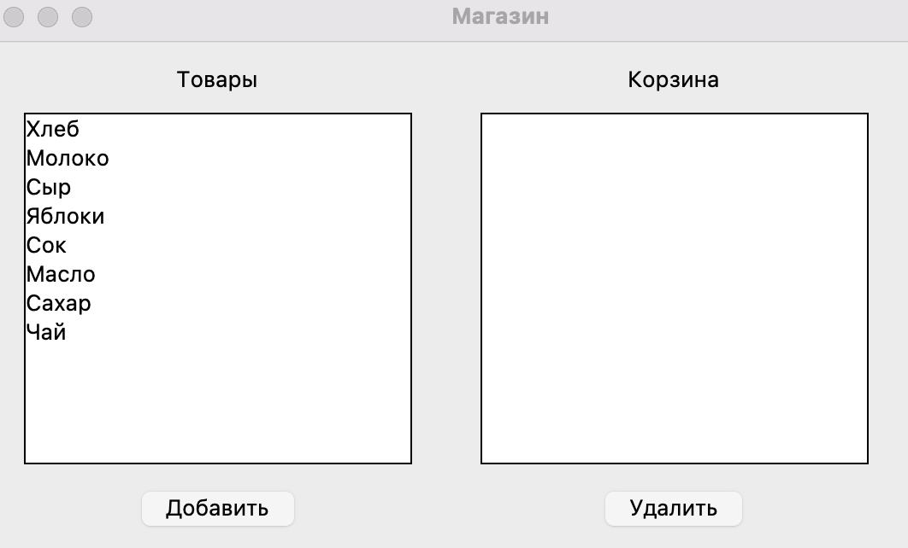

# Корзина товаров на Python

Учебная лабораторная работа на Python с использованием tkinter.

## Возможности
- Просмотр списка товаров
- Добавление товаров в корзину
- Удаление товаров из корзины
- Выбор нескольких товаров одновременно

## Запуск
Требуется Python 3.

python "lab6_V2(2).py"

## Пример работы
Программа открывает окно с двумя списками: товары и корзина. Пользователь может добавлять и удалять товары.

## Скриншот программы

